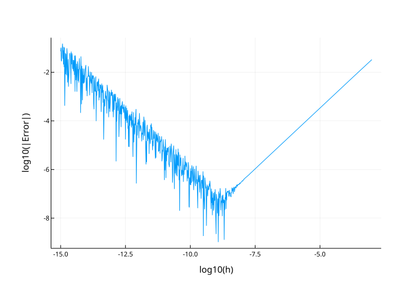
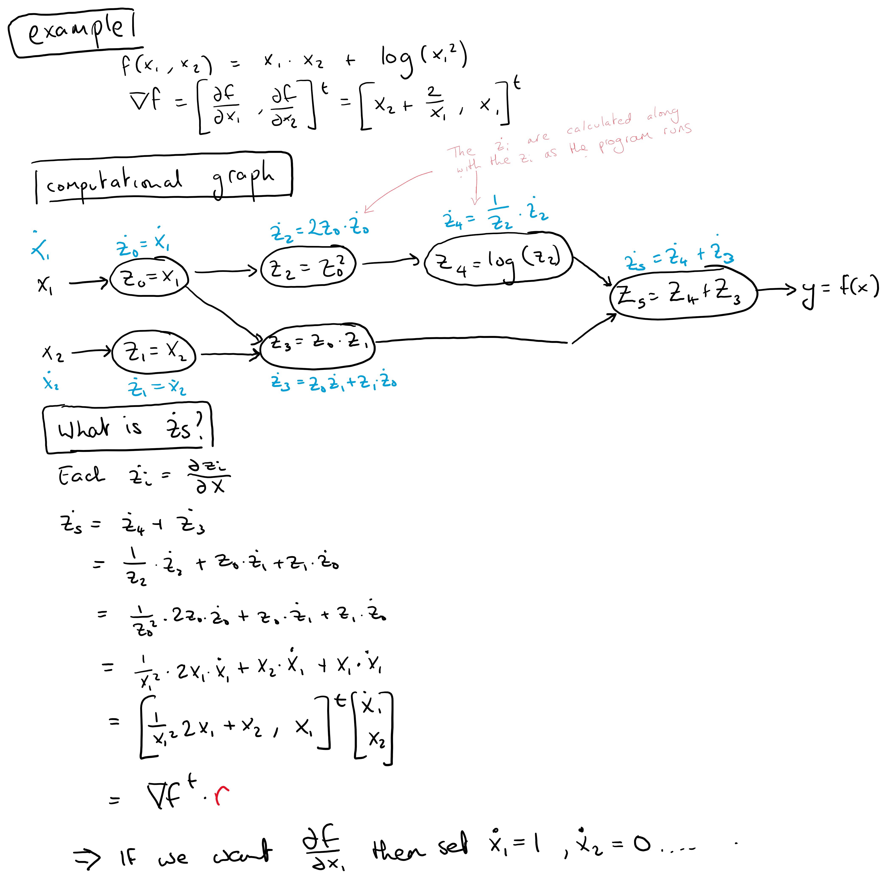

::: {.callout-note}
A look at the first half (up to section 3.1) of the survey paper by @baydin2018automatic
 
Baydin, A. G., Pearlmutter, B. A., Radul, A. A., & Siskind, J. M. (2018). Automatic differentiation in machine learning: a survey. Journal of machine learning research, 18.  

[https://www.jmlr.org/papers/volume18/17-468/17-468.pdf](https://www.jmlr.org/papers/volume18/17-468/17-468.pdf)
:::

## Introduction
Automatic differentiation (autodiff) reminds me of Arthur C. Clarke's quote "any sufficiently advanced technology is indistinguishable from magic". Whereas computer based symbolic and numerical 
differentiation seem like natural descendants from blackboard based calculus, the first time I learnt
about autodiff (through [Pytorch](https://pytorch.org/)) I was amazed (but maybe that's just because I'm bad at math). Indeed, it is not that the ideas underlying autodiff themselves
are particularly complex, indeed @baydin2018automatic look at the history of autodiff puts the paper by @wengert1964simple entitled "A simple automatic derivative evaluation program" as a key moment in forward mode
autodiff history. (BTW the paper is only 2 pages long - well worth taking a look). For me the magic comes from autodiff being this digitally
inspired look at something as "ordinary" but so important to scientific computing and AI as differentiation.

## Differentiation
If you are unsure of what the terms symbolic or numerical differentiation mean, I'll give a a quick
overview below but would encourage you to read
the paper and it's references for a more detailed exposition of their various 
strengths and weaknesses. 

### Numeric differentiation - wiggle the input

For a function $f$ with a 1D input and output describing numeric differentiation (also known as the finite difference method) comes quite naturally from the definition of the derivative. The derivative is
$$\frac{df}{dx} = \text{lim}_{h \rightarrow 0}\frac{f(x+h)-f(x)}{h}$$ so we approximate this expression by picking a small enough $h$ 
(there are more complex schemes). 
There are two sources of error here, the first is from approximating the infinitesimally small $h$ with a plain finitely small $h$ (*truncation error*) and
the second is from *round-off error*. 
Round-off error occurs because not every number is represented in the set of floating point numbers so for a small $h$ the difference $f(x+h)-f(x)$ can be quite unstable. Unfortunately these two source of error play against each other (see graph - on the left hand size round-off error dominates whereas on the right hand side truncation error dominates).

```julia
using Plots
plotlyjs()
h = 10 .^ range(-15, -3, length=1000)
x0 = 0.2
f(x) = (64*x*(1-x)*(1-2*x)^2)*(1-8*x+8*x^2)^2
df = (f.(x0 .+ h) .- f(x0)) ./ h
plot(log10.(h),log10.(abs.((df .- 9.0660864))),
xlabel="log10(h)",ylabel="log10(|Error|)",legend=false)
```

{width=100%}

However, such small errors are actually not all that important in machine learning! The main issue with numeric
differentiation for machine learning is that the number of required evaluations of our function $f$
scales linearly with the number of dimension of the gradient. In contrast backpropagation (an autodiff method) can calculate the 
derivatives in "two" evaluations of our function (one forward, one back). 

### Symbolic - fancy lookup tables

Symbolic differentiation is differentiation as you learnt it in school programmed into software, all the rules
$\frac{d}{dx}\text{cos}(x) = -\text{sin}(x), \frac{d}{dx} x^p = px^{(p-1)}, \frac{d}{dx}f(g(x)) = f'(g(x))g'(x)$ etc... are known and utilised by the software. If you evaluate the derivative of a 
function `f` using a symbolic programming language `dfdx = derivative(f,x)` the object returned `dfdx` is just whatever function the symbolic program matches as the derivative of `f` using it's internal derivative lookup and application of the rules of differentiation (chain rule etc). **It is manipulation of expressions**. 
The main issue with symbolic differentiation for ML (which anyone who has
used Mathematica for a help with a difficult problem can attest to) is expression swell, where the derivative expression is exponentially longer than the original expression and involves repeated calculations.

### Automatic differentiation - alter the program

Autodiff is the augmentation of a computer program to perform standard computations along with **calculation
of derivatives**, there is no manipulation of expressions. It takes advantage of the fact that derivative expressions can be broken down into 
elementary operations that can be combined to give the derivative of the overall 
expression. I'll be more clear about elementary operations soon but you can think of an elementary operations as being any operation you could give to a node on a computational graph of your program.

## Forward mode

To be more concrete about autodiff, let's look at forward mode. Consider evaluating $f(x_1,x_2) = x_1 x_2 + \text{log}(x_1 ^2)$. We break this into the computational graph below and associate with each elementary operation the intermediate variable 
$\dot{v}_i = \frac{\partial v_i}{\partial x}$, called the "tangent". The final "tangent" value $\dot{v}_5$, which has been calculated as the function evaluates at the input (3,5) is a derivative at the point (3,5). What derivative exactly depends on the initial values of $\dot{x_1}$ and $\dot{x_2}$. 

{width=100%}

## Sketching a forward mode autodiff library

It's surprisingly easy to implement forward mode autodiff in [Julia](http://www.julialang.org) 
(at least a naive form). Below I create a forward model module that creates a new object `Dual` that
is a type of `Number`, and then proceed to overload common mathematical functions (e.g. `sin` and `*`)
to account for this new number type. Each instance of `Dual` with have a `p`rime and `t`angent slot. 
If we want the derivative with respect to argument `x₁` of the function `y = f(x₁,x₂)`  we 
simply set `x₁.t = 1.0` (leaving `x₂.t = 0.0`) and check the value of `y.t`.
For more see [this video](https://www.youtube.com/watch?v=vAp6nUMrKYg&t=363s) 
from MIT's Alan Edelman 

```{julia}
#| eval: true
#| echo: true
import Base: +,-,/,*,^,sin,cos,exp,log,convert,promote_rule,println

struct Dual <: Number
  p::Number # prime
  t::Number # tangent
end

+(x::Dual,y::Dual) = Dual(x.p + y.p, x.t + y.t)

-(x::Dual,y::Dual) = Dual(x.p - y.p, x.t - y.t)

/(x::Dual,y::Dual) = Dual(x.p/y.p, (x.t*y.p - x.p*y.t)/x.p^2)

*(x::Dual,y::Dual) = Dual(x.p*y.p, x.t*y.p + x.p*y.t)

sin(x::Dual) = Dual(sin(x.p), cos(x.p) * x.t)

cos(x::Dual) = Dual(cos(x.p), -sin(x.p) * x.t)

exp(x::Dual) = Dual(exp(x.p), exp(x.p) * x.t)

log(x::Dual) = Dual(log(x.p), (1/x.p) * x.t)

^(x::Dual,p::Int) = Dual(x.p^p,p*x.p^(p-1)* x.t)

## We can think of dual numbers analogously to complex numbers
## The epsilon term will be the derivative
println(x::Dual) = println(x.p," + ",x.t,"ϵ")

## deal with conversion, and Dual with non-Dual math
convert(::Type{Dual}, x::Number) = Dual((x,zero(x)))
promote_rule(::Type{Dual},::Type{<:Number}) = Dual;
```

Lets test on our example $f(x_1,x_2) = x_1 x_2 + \text{log}(x_1 ^2)$, the derivative
at (3,5) should be $5 \frac{2}{3}$.

```{julia}
#| eval: true
#| echo: true
x1 = Dual(3.0,1.0)
x2 = Dual(5.0,0.0)
f(x1,x2) = x1*x2 + log(x1^2)
y = f(x1,x2)
## df/dx1
println(y.t)
## direct calculation
println(x2.p + 2/x1.p)
```

## Conclusion

Thanks for reading this quick tour of automatic differentiation! 
Autodiff is important in machine learning and scientific computing, underpinning the training of deep learning models and scientific simulations. 
As shown above forward mode (derivatives wrt the input) is surprisingly easy to implement. Reverse mode (derivatives wrt the output, as used for deep learning) is a bit more complex.

## References

::: {#refs}
:::